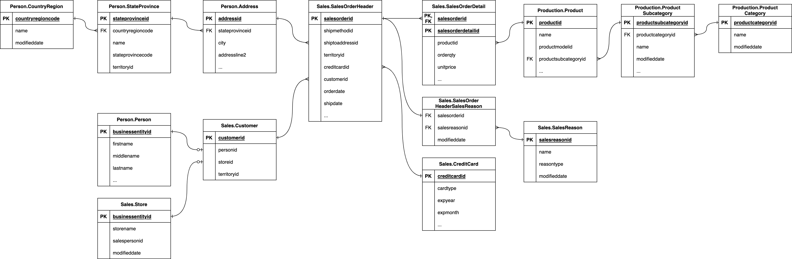

## Part 1: Setup dbt project and database

### Step 1: Before you get started

Before you can get started:

- You must have a Snowflake account with a warehouse, database, and role you can create schemas in (a free [Snowflake trial account](https://signup.snowflake.com/) is enough to follow along).
- You must have Python 3.8 or above installed.
- You must have `pip` installed.
- You should have a basic understanding of [SQL](https://www.sqltutorial.org/).
- You should have a basic understanding of [dbt](part00-intro-to-dbt.md) — see Part 0 if you skipped it.

### Step 2: Clone the repository

Clone the repository by running this command in your terminal:

```text
git clone https://github.com/ultramanguan/dbt-dimensional-model.git
cd dbt-dimensional-model/adventureworks
```

### Step 3: Install dbt and the Snowflake adapter

```text
pip install -r ../requirements.txt
```

This installs `dbt-snowflake` (which pulls in a matching `dbt-core` automatically), plus `sqlfluff` for linting.

### Step 4: Create Snowflake objects for this project

In a Snowflake worksheet, as a role that can create resources (e.g. `ACCOUNTADMIN` or a role your Snowflake admin has granted `CREATE` privileges to), run:

```sql
create warehouse if not exists dbt_wh with warehouse_size = 'xsmall' auto_suspend = 60 auto_resume = true;
create database if not exists dbt_db;
create role if not exists dbt_role;
create user if not exists dbt_user default_role = dbt_role default_warehouse = dbt_wh;
grant usage on warehouse dbt_wh to role dbt_role;
grant usage, create schema on database dbt_db to role dbt_role;
grant role dbt_role to user dbt_user;
```

If you'd rather use your existing Snowflake user instead of creating `dbt_user`, just grant `dbt_role` to that user instead. Either way, this project logs in with a **key pair, not a password** (Step 5). Many Snowflake accounts require MFA for passwords, and dbt cannot answer an MFA prompt.

> **Check your authentication policy.** If your account (or the user) has an [authentication policy](https://docs.snowflake.com/en/user-guide/authentication-policies), it must allow `KEYPAIR`, otherwise login fails with error `390202` even with a valid key. Check with `show authentication policies in account;` and `desc authentication policy <name>;`. If `AUTHENTICATION_METHODS` doesn't include `KEYPAIR`, an admin can add it:
>
> ```sql
> alter authentication policy <db>.<schema>.<policy_name>
>   set authentication_methods = ('PASSWORD', 'KEYPAIR');
> ```
>
> `CLIENT_TYPES` must also allow `DRIVERS` (the default `ALL` is fine).

### Step 5: Set your connection as environment variables

`adventureworks/profiles.yml` is already configured to read your Snowflake connection details from environment variables, so no credentials are ever committed to git. Set these in your shell (add them to `~/.zshrc`/`~/.bashrc` to persist across sessions):

```bash
export DBT_SNOWFLAKE_ACCOUNT="your_account_identifier"   # e.g. xy12345.us-east-1
export DBT_SNOWFLAKE_USER="dbt_user"   # or your own username if you skipped creating dbt_user
export DBT_SNOWFLAKE_PRIVATE_KEY_PATH="$HOME/.ssh/snowflake_dbt_key.p8"
export DBT_SNOWFLAKE_ROLE="dbt_role"
export DBT_SNOWFLAKE_DATABASE="dbt_db"
export DBT_SNOWFLAKE_WAREHOUSE="dbt_wh"
export DBT_SNOWFLAKE_SCHEMA="dbt_schema"
```

The profile uses [key-pair authentication](https://docs.getdbt.com/docs/core/connect-data-platform/snowflake-setup#key-pair-authentication), which works on accounts that enforce MFA. Generate a key pair and register the public key on your Snowflake user:

```bash
openssl genrsa 2048 | openssl pkcs8 -topk8 -inform PEM -out ~/.ssh/snowflake_dbt_key.p8 -nocrypt
openssl rsa -in ~/.ssh/snowflake_dbt_key.p8 -pubout -out ~/.ssh/snowflake_dbt_key.pub
```

```sql
alter user dbt_user set rsa_public_key = '<contents of the .pub file, without the BEGIN/END lines>';
```

If you protect the private key with a passphrase, drop `-nocrypt` and add `private_key_passphrase` to `profiles.yml`. Because the key has no passphrase here, keep the `.p8` file out of git and readable only by you (`chmod 600`).

### Step 6: Verify the connection

```text
dbt debug
```

Expected output ends with `All checks passed!`. If it doesn't, re-check the environment variables from Step 5 — `dbt debug` prints exactly which check failed.

Common connection errors:

| Error | Cause | Fix |
|---|---|---|
| `390190` SAML Identity Provider parameter | `profiles.yml` was set to `authenticator: externalbrowser` (SSO) but the account has no SAML IdP configured | Remove `authenticator`; use key-pair auth as above |
| `394509` MFA authentication is required | Logging in with a password on an account that enforces MFA | Use key-pair auth; don't use `password` |
| `390202` rejected by the current authentication policy | The policy on the user/account doesn't allow `KEYPAIR` | Add `KEYPAIR` to `AUTHENTICATION_METHODS` (see the Step 4 note) |
| JWT token invalid / invalid public key | Public key registered on a different user than `DBT_SNOWFLAKE_USER`, or pasted with the BEGIN/END lines | Re-run `alter user ... set rsa_public_key`; check `desc user <user>` shows `RSA_PUBLIC_KEY_FP` |

### Step 7: Install dbt package dependencies

We use packages like [dbt_utils](https://hub.getdbt.com/dbt-labs/dbt_utils/latest/) in this project. `dbt deps` reads the version range in `packages.yml`, resolves it against the dbt Hub, and writes the exact resolved version to `package-lock.yml`, which you should commit so everyone (and CI) installs the identical package version:

```text
dbt deps
```

### Step 8: Seed your database

We are using [dbt seeds](https://docs.getdbt.com/docs/build/seeds) (see `adventureworks/seeds/*`) to insert AdventureWorks data into Snowflake:

```text
dbt seed
```

### Step 9: Examine the database source schema

All data generated by the business is stored on an OLTP database. The Entity Relationship Diagram (ERD) of the database has been provided to you.

Examine the database source schema below, paying close attention to:

- Tables
- Keys
- Relationships



*Source schema*

### Step 10: Query the tables

Get a better sense of what the records look like by executing select statements in a Snowflake worksheet.

For example:

```sql
select * from dbt_db.sales.salesorderheader limit 10;
```

When you've successfully set up the dbt project and Snowflake, we can now move into the next part to identify the tables required for a dimensional model.

[&laquo; Previous](part00b-data-modeling-fundamentals.md) [Next &raquo;](part02-identify-business-process.md)
