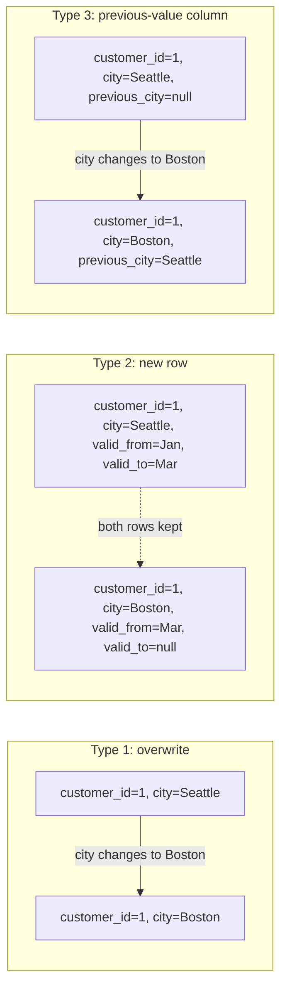
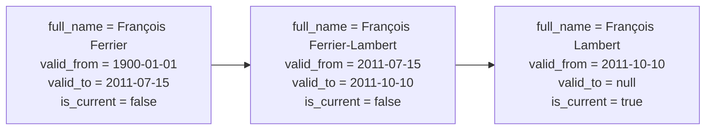

## Part 4b: Slowly changing dimensions (SCD Types 1, 2, and 3)

Every dimension we built in Part 4 (and `dim_customer`, once we make it Type 2 below) answers "what does this entity look like *right now*?" But source values change: a customer moves and gets a new address, a product's name gets corrected, a person's last name changes. A **slowly changing dimension (SCD)** strategy decides what happens to the dimension table when that happens.

There are three classic strategies:

| Type | What happens on a change | History kept | Query complexity |
| --- | --- | --- | --- |
| **Type 1** | Overwrite the old value | None — only the current value exists | Simplest: one row per entity, always current |
| **Type 2** | Insert a new row, close out the old one | Full history, one row per version | Need a `valid_from`/`valid_to` (or `is_current`) filter to pick a point in time |
| **Type 3** | Add a `previous_x` column, overwrite the current one | Limited: only the immediately prior value | Simple, but can't go back more than one change |



### SCD Type 1 — overwrite (no history)

You've already built Type 1 dimensions without realizing it. Every dimension in Part 4 (product, address, credit card, order status, date) is materialized as a full-refresh `table`: each `dbt run` truncates and rebuilds it from the current state of the source data. If a product's name changes in `product.csv` and you re-seed and re-run, `dim_product` simply shows the new name — the old one is gone. That *is* Type 1. `dim_customer` is the one exception: it is our Type 2 example, covered next.

Full-refresh works fine at this project's scale (a few thousand rows). At production scale (millions of rows), rebuilding the whole table on every run is wasteful, so Type 1 is usually implemented as an `incremental` model that merges only changed rows instead:

```sql
{{ config(materialized='incremental', unique_key='product_id', incremental_strategy='merge') }}

select
    product_id,
    product_name,
    product_number,
    modified_date
from {{ ref('stg_production__product') }}


where modified_date > (select coalesce(max(modified_date), '1900-01-01') from {{ this }})

```

The `merge` strategy overwrites any row whose `unique_key` already exists — same overwrite-in-place behavior as the full-refresh table, just without touching unchanged rows.

### SCD Type 2 — full history (hands-on)

dbt has first-class support for Type 2 via [snapshots](https://docs.getdbt.com/docs/build/snapshots). A snapshot is a special kind of model that, on every `dbt snapshot` run, compares the current source data against what it captured last time and inserts a new row *only* for entities whose tracked columns changed — closing out the previous row's `dbt_valid_to` rather than overwriting it.

This project includes a working example: `adventureworks/snapshots/scd_person_snapshot.sql` tracks the `person` table (via `stg_person__person`) using a `timestamp` strategy against its `modified_date` column, and `adventureworks/models/marts/dim_customer.sql` builds the project's customer dimension on top of it. `dim_customer` is a Type 2 dimension: one row per customer per version, with `valid_from`, `valid_to` and `is_current`. Customers with no person history get a single row, and the first version of every customer starts at `1900-01-01` so that orders placed before the first recorded change still find a version.

Real source systems change over time, but a seed file is a static snapshot. To mimic that, this project ships `adventureworks/seeds/person/person_changes.csv`: seven dated changes to the `person` table, grouped into three **batches**. The `person_batch` var controls how many batches have "arrived" — `stg_person__person` (which feeds the snapshot) applies the original `person` seed plus every change with `batch <= person_batch`. Each `dbt snapshot` run then captures whatever the source looks like at that moment, exactly like a nightly production run would.

| Batch | `modifieddate` | Change | Real-world case |
| --- | --- | --- | --- |
| 1 | 2011-07-15 | Person 317: last name `Ferrier` → `Ferrier-Lambert` | A name change |
| 1 | 2011-07-15 | Person 391: middle name `A.` → `Alan` | An attribute is enriched |
| 1 | 2011-07-15 | Person 439: first name `Shane` → `Shayne` | A source-side correction |
| 2 | 2011-10-10 | Person 317: last name → `Lambert` | A second change to the same person |
| 2 | 2011-10-10 | Person 391: middle name `Alan` → `A.` | A value reverts to an earlier one |
| 2 | 2011-10-10 | Person 295 appears (`Jordan T. Whitaker`) | A late-arriving record: customer 29486 exists, but its person record doesn't until now |
| 3 | 2011-11-20 | Person 483 is deleted | A hard delete at the source |

Try it yourself, running the batches **in order** (the snapshot only moves forward):

0. *(Optional)* Clean up any earlier run. A snapshot table remembers every version it has ever seen, so if you've run this walkthrough before — or snapshotted at a higher `person_batch` — drop it first. In a Snowflake worksheet:
   ```sql
   drop table if exists dbt_db.snapshots.scd_person_snapshot;
   ```
   Skip this on a first run. The dimension and fact tables are rebuilt from scratch by `dbt run`, so nothing else needs cleaning.
1. Load the seeds, build the staging view the snapshot reads, and take the first snapshot (no changes applied yet):
   ```
   dbt seed
   dbt run --select stg_person__person --vars '{person_batch: 0}'
   dbt snapshot
   ```
2. Apply each batch: rebuild the staging view with the new `person_batch` (the var is baked into the view when it's built, so `dbt snapshot --vars` alone would change nothing), then snapshot again:
   ```
   dbt run --select stg_person__person --vars '{person_batch: 1}'
   dbt snapshot
   dbt run --select stg_person__person --vars '{person_batch: 2}'
   dbt snapshot
   dbt run --select stg_person__person --vars '{person_batch: 3}'
   dbt snapshot
   ```
3. Build the models:
   ```
   dbt run --select +dim_customer
   dbt run --select dim_product dim_address dim_credit_card dim_order_status dim_date
   dbt run --select fct_sales --full-refresh
   ```
4. Query `dim_customer` for `customer_id` 29497 (person 317). You see **three** rows, each closed out by the next version's `valid_from` (the first starts at `1900-01-01`, the placeholder start date for every customer's first version):


*Three rows for `customer_id = 29497` after batches 1 and 2 — each change closed out the previous version instead of overwriting it.*

What to look for in each case:

- **Revert (customer 29533):** the name returns to `Douglas A. Baldwin`, so versions 1 and 3 have the same `full_name`. They are still separate rows with different `valid_from` values — which is why `valid_from` is part of `customer_key`.
- **Late-arriving record (customer 29486):** the person record only arrives in batch 2. The customer has a single row from `1900-01-01`, so both of its orders (2011-08-01 and 2011-10-31) join to it and show the name that is known now. Backfilling the first version to the beginning of time is the usual way to handle records that arrive late.
- **Hard delete (customer 29565):** the row stays in the dimension, but it's closed out (`is_current = false`) because the snapshot uses `hard_deletes='invalidate'`. Its `valid_to` is the time the snapshot ran, not the date in the source.
- **Point-in-time join:** `fct_sales` looks up `customer_key` from `dim_customer` by picking the version that was valid on the order date (`valid_from <= order_date < valid_to`). Customer 29497's three orders (2011-05-31, 2011-08-31, 2011-12-01) land on three different versions, so each order keeps the name the customer had when they placed it. Re-run `fct_sales` with `--full-refresh` after changing the dimension history, as in step 3, because an incremental run does not revisit old orders. Compare with `fct_sales`, which joins to the Type 1 `dim_customer` and only ever shows the current name.

To start over, repeat from step 0. Don't snapshot after rebuilding the view with a *lower* `person_batch` than before: the snapshot would treat records missing from the older state as deleted.

One limitation worth knowing: the snapshot uses the `timestamp` strategy, so it only notices a change when the source row's `modified_date` moves forward. A source system that edits a row without bumping `modified_date` would be missed. The `check` strategy, which compares column values instead, handles that case at the cost of comparing every tracked column on every run.

This is exactly why the snapshot's `unique_key` (`business_entity_id`) matters: it's how dbt knows these two rows are different *versions of the same entity*, not two different people.

### SCD Type 3 — limited history (previous-value column)

Type 3 is a middle ground: instead of a new row, you add a `previous_x` column that remembers only the value immediately before the current one. It's cheap to query (still one row per entity) but can't answer "what was this three changes ago?" — only "what was this right before now?"

There's no dedicated dbt feature for Type 3 (unlike snapshots for Type 2); it's typically hand-rolled as a self-referencing incremental model that compares the incoming row to what's already in the table (`{{ this }}`):

```sql
{{ config(materialized='incremental', unique_key='address_id') }}

with source as (
    select address_id, city_name, modified_date
    from {{ ref('stg_person__address') }}
),


existing as (
    select address_id, city_name, previous_city_name
    from {{ this }}
),

final as (
    select
        source.address_id,
        source.city_name,
        case
            when existing.city_name is distinct from source.city_name then existing.city_name
            else existing.previous_city_name
        end as previous_city_name
    from source
    left join existing using (address_id)
)

final as (
    select address_id, city_name, cast(null as varchar) as previous_city_name
    from source
)


select * from final
```

The key idea: `previous_city_name` only updates when `city_name` actually changed since the last run — otherwise it keeps carrying forward whatever it already held.

### Choosing between them

- Use **Type 1** for corrections (typos, data-quality fixes) where the old value was simply wrong and history has no value.
- Use **Type 2** whenever "what did this look like at the time of the transaction" matters for reporting — e.g. you want `fct_sales` to join to the customer's name *as of the order date*, not their current name. That is exactly how `dim_customer` and `fct_sales` work in this project.
- Use **Type 3** for the rare case where you specifically need "current vs. immediately-previous" (e.g. "customers who moved this quarter") and don't need deeper history.

[&laquo; Previous](part04-create-dimension.md) [Next &raquo;](part05-create-fact.md)
